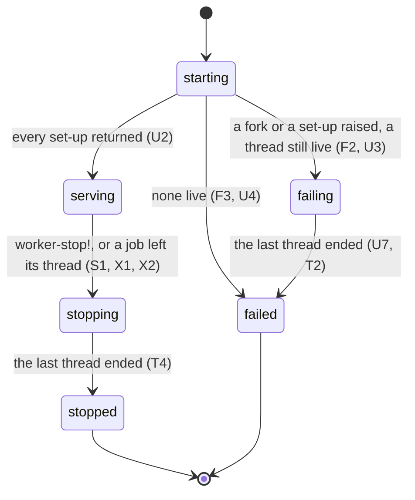

# Design: a worker, modelled and verified

#53's item 3 asks for a worker: a library that runs a handler's blocking job, such as a
SQLite query, on threads of its own while the loop serves everyone else. Its first
comment adds question 7, several threads with a state each, and asks that the worker be
modelled as state machines and verified, not only tested (#53 §10).

Read against: circuit at `442dd85`, chez-http-server v0.12.0 (`bba2ba6`, its decision
0039, `docs/waiting.md` and `(http-server private waits)`), and Chez 10.4.1 threaded in
the container. Every claim below about Chez or the server was probed there (§12) or read
in the pinned source.

Status: approved by the owner on 2026-11-23 ("approved"), with ADR-0013 accepted. It
was revised three times, each time on an adversarial review (§14). The owner answered
on 2026-11-23:

- Q1, "Never run it";
- Q3, "Refuse them";
- Q8, "One thread of its own";
- a second review of the revision before ADR-0013;
- after it, Q14, "make-test-worker", and ADR-0013 to be written.

Q2, Q4 to Q7 and Q9 to Q13 stand as recommended unless the owner says otherwise.
ADR-0013 records them all.

## 1. Reading #53 closely

#53's job diagram (§4.2), its table and its plan for verification (§10) are the
starting point. Read against the server's contract, nine things in them need changing
before they can be built and checked.

1. **"Running → Answered" is two steps, with the server in between.** The worker
   posts the answer, and the loop delivers it later. A deadline can reach the wait
   between the two, and then the server drops the answer (decision 0039, item 5).
   `resume`'s `#t` means posted, not seen. So the job's machine ends at *posted*, and
   the server's wait decides *answered* or *lost*.
2. **"Abandoned" is three states with different futures.**
   - A job not yet begun whose caller has gone can be dropped before it runs. That is
     either a queued job, or one given to a thread that hasn't started it.
   - A running job holds its thread until it ends, and its answer is not wanted.

   The diagram has one state for all of them, so question 1's answer can't be written
   into it.
3. **The diagram has no stop.** There are no rows for a queued or a running job at
   `worker-stop!`, and no row for a call while the stop runs.
4. **The diagram has no server stop.** Once the server stops, `resume` answers `#f`,
   and a handler still waiting is never woken (decision 0039's consequences). The job
   still runs. So L1, "no handler waits for ever", holds only while the server serves.
5. **With several threads, "queue at its cap" is the wrong test for a refusal.** If
   threads take jobs from the queue themselves, a burst of calls can fill the queue
   before an idle thread wakes, and a call is refused while a thread sits idle. Here a
   call gives its job to an idle thread at once, under the lock. It is refused only
   when no thread is idle and the queue is full, which is S9.
6. **§10.3's layer 2, "every row driven against the inline double", can't be done.**
   The double has no queue, so it can't reach Queued, full, or a stop with jobs
   queued. Every row is driven against the pure step function instead. The job's rows
   are driven again against the real worker, on real threads, under a schedule the test
   sets (§8.4).
7. **§10.3's layer 3 explores the step function, but most of the risk is in the
   protocol around it.** A lost wakeup can happen in the thread loop even when every
   decision is right: a signal sent while no thread waits is gone. The server's half
   matters too. So the explored world holds three things:
   - the real step function;
   - a model of the shell's protocol: each thread's place in its loop, its signals, and
     the effects carried out after the lock is released;
   - a model of the server's contract, which rows against the real server hold to it
     (§8.6).
8. **§10.4's properties need sharpening, and several are missing.**
   - S4, "a thread's state is touched only by that thread", is a property of the
     shell's code, not of the step function: the state never enters the shared record
     (R8).
   - L3 becomes an invariant: no thread is idle while the queue holds a job.
   - S10 to S16 and L4 are new (§7).
9. **§10.3's layer 6, TLA+, isn't needed while there is one lock.**
   - Each explored world is finite, and the explorer fails if its graph has a cycle.
   - So every run that keeps scheduling enabled events ends in a terminal world.
   - Checking every terminal world then checks L1 to L4 in that world. The one
     fairness it assumes is the OS's: a thread that can run eventually does.
   - A spurious wakeup spends one of a bounded budget kept in the world, so it can't
     make a cycle.
   - The cost is the small-scope assumption, which §8.7 names.

## 2. The shape

| Library | What it is | Imports |
|---|---|---|
| `(circuit worker machine)` | the pure step function and its tables as data | `(rnrs)` alone: a core library, internal |
| `(circuit worker shell)` | the shell: threads, the lock, the protocol, the double, and an observer hook for tests | the machine, `(only (http-server) await-outside deadline-passed? client-closed?)`, `(only (chezscheme) fork-thread thread-join make-mutex mutex-acquire mutex-release make-condition condition-wait condition-signal condition-broadcast disable-interrupts enable-interrupts make-thread-parameter get-thread-id)`; internal |
| `(circuit worker)` | the API (§3), re-exported from the shell without the hook, and `wrap-busy` | the shell, and core circuit libraries for `wrap-busy` |

- **The shell imports the server, and the facade reaches it through the shell.** With
  `(circuit websocket)`, which reaches the server through `(websocket)`, they are the
  fourth and fifth impure libraries. An amendment to ADR-0006's items 1, 2 and 4 does
  three things:
  - **names the shell beside the adapter and `(circuit middleware waits)`,** in items
    1 and 2;
  - **gives the shell's `(chezscheme)` names an allowlist of their own.** No other
    library may use them. In `make check-imports`, rule (d)'s one list of
    `(chezscheme)` names becomes a list per library, and rules (b) and (c) name the new
    libraries;
  - **lets `(circuit worker)` import `(circuit worker shell)`, by a new rule like
    (i).** Item 4 and rules (d) and (i) say no library imports an impure one, and the
    audit refuses every such import (`tests/check-imports.sps:502-504`). This is the
    one exception.

  No other library imports either one.
- **What is public.** `(circuit)`, the pure facade, doesn't re-export the worker.
  `(circuit worker)` is the thirteenth public library, with a reference section, type
  aliases for `Worker` and `State` (a set-up's value), and a docs page.
  `tests/test-reference.sps`' `internal-exports` gains only the names no public
  library exports:
  - the machine's;
  - the shell's constructor, which takes an observer and a `step` to use in place of the
    machine's (R11's rows inject one that raises);
  - the shell's live count.
- **No global state.** Every mutex, condition and record belongs to one worker. One
  thread parameter holds, on each worker thread, that thread's own id, for S13. A
  thread a job forks inherits the parameter but not the id, so the check is by id.

## 3. The API

```scheme
;; make-worker : (-> State) Nat [Nat] [(State -> Any)] -> Worker
;;   set-up, cap, threads (default 1, at least 1), tear-down (default: none)
;; worker-call : Worker (State -> Any) -> Any        ; the job's values, on a coroutine
;; worker-stop! : Worker -> Void
;; worker? : Any -> Boolean
;; make-test-worker : (-> State) [(State -> Any)] -> Worker   ; the double, Q8
;; &worker-full : ConditionType
;; worker-full? : Any -> Boolean
;; &worker-stopped : ConditionType
;; worker-stopped? : Any -> Boolean
;; wrap-busy : Nat -> Middleware                    ; 503, Retry-After: n
```

- **`(make-worker set-up cap threads tear-down)`**
  - It forks `threads` threads. Each runs `set-up` once, and its value is that
    thread's state.
  - It returns once every set-up has returned. Or, once every forked thread has been
    joined, it raises the lowest thread's fork or set-up raise (Q4).
  - `cap` is how many jobs may wait while every thread is busy: a whole number,
    possibly 0 or a bignum.
  - `threads` is a positive fixnum.
  - Each argument is checked before anything is forked, by `assertion-violation` with
    `who` `make-worker`.
- **`(worker-call w job)`**
  - It runs `(job state)` on one of `w`'s threads, and answers the job's values,
    however many. If the job raised, it raises the same object. A warning raised
    plainly, which isn't continuable, arrives as the `&non-continuable` Chez makes of
    it (probed).
  - It waits with `await-outside`, so it works wherever a wait does: in every circuit
    handler, since the adapter answers each request with `awaiting`.
  - Raises:
    - `&worker-full` when no thread is idle and the queue holds `cap` jobs;
    - `&worker-stopped` once a stop has begun, and for a job told at the stop;
    - `&deadline-passed` or `&client-closed`, unchanged, when the wait ends first;
    - an `&error` that says so when the job left its thread (Q9);
    - an `&error` that says so once the worker is broken (R11).
- **`(worker-stop! w)`**
  - It refuses the jobs not yet begun, waits for the running ones, runs `tear-down` on
    each thread, and joins every thread (Q3).
  - It then raises the lowest thread's tear-down raise, if any.
  - It may be called again, from any thread but a worker's, and each call answers the
    same.
  - On any worker's own thread it is refused by `assertion-violation` (S13).
- **Arguments.** `worker-call` and `worker-stop!` refuse a value that isn't a worker,
  and `worker-call` a job that isn't a procedure, by `assertion-violation` with their
  own `who`, before anything else.
- **`make-test-worker`** is the double for an app's tests (Q8, Q14).
- **`wrap-busy`** answers an empty 503 with `Retry-After: n` for `&worker-full` and
  `&worker-stopped`, and passes everything else on. It is built as `wrap-catch` is, with
  `with-exception-handler`. It goes inside `wrap-catch`, which would otherwise turn
  either refusal into a 500 with a `handler-failed` line (Q11).
- **Interrupt handlers.** No worker procedure may be called from an interrupt handler,
  such as a signal handler, a timer or an engine, and nothing refuses one (R5).
  - Most interrupts land where the thread doesn't hold the worker's lock, and the call
    runs as from anywhere.
  - One can land while the thread holds it:
    - between taking `m` and disabling interrupts;
    - around a held step, whose interrupts are enabled again while `m` is still held
      for the `condition-wait` after it.
  - There, a `worker-call` parks holding `m`, since `await-outside` always parks, and
    the worker hangs (probed).
  - A `worker-stop!` of the same worker raises "recursively locked" at its wait, which
    breaks the worker (R11). A `make-worker` makes a mutex of its own, so it isn't
    affected.

## 4. The machines

### 4.1 The state and the step

`step : Machine Event -> (values Machine Reply Effects)` is pure. `Machine` is an
immutable record. It isn't `State`, the alias for a set-up's value, since
`tests/test-reference.sps` holds each alias name to one type:

- **`phase`**: starting, failing, serving, stopping, stopped or failed.
- **`slots`**, one per thread, each one of:
  - unborn;
  - setting-up;
  - idle;
  - given k: k is handed over, but its thread hasn't begun it;
  - running k;
  - dropping k: running a job whose caller has gone;
  - tearing-down;
  - ended.

  Here k is a ticket, opaque to the machine and compared by `eq?`.
- **`queue`**: tickets in call order, at most `cap`. It is a two-list queue, so an
  enqueue is O(1) amortized.
- **`raises`**: what a fork, a set-up or a tear-down raised, by thread.

A job's own state is where its ticket is: in the queue, in a slot, or gone. So there is
no table of jobs to keep in step with the rest. The explorer keeps each job's history as
ghost state of its own (§8.3).

**A `Reply` goes to the party that stepped:**

- a caller: accepted, full or stopped;
- a thread: wait, run k, tear-down or end;
- the maker: wait, ready, or failed e, with the lowest fork or set-up raise;
- a stopper: wait, stopped with the lowest tear-down raise or none, or refused.

**`Effects` go to everyone else,** in order:

- **`(post k outcome)`**: call k's `resume`. `outcome` is the job's values or its raise,
  stopped, or left. The shell turns stopped into a `&worker-stopped` condition, and
  left into an `&error`.
- **`(signal t)`**: wake thread t.
- **`(wake-waiters)`**: a broadcast to the maker and every stopper.

### 4.2 The rows

Each row is `(phase, event, where, guard) → (changes, reply, effects)`. "Can't happen"
rows are rows too: the static check counts them, and the explorer fails if one fires.
"Live" means not ended.

**Fork**, by the maker, holding the lock while it forks; every slot is unborn:

| # | Event | Guard | Changes | Reply |
|---|---|---|---|---|
| F1 | every fork made | | slots setting-up | wait |
| F2 | fork i raises e | i > 1 | failing; slots 1..i-1 setting-up, i.. ended; raise (fork i e) | wait |
| F3 | fork 1 raises e | | failed; slots ended; raise (fork 1 e) | failed e |

A fork outside starting can't happen.

**Look**, by the maker, after F1 or F2 and after each wake:

| # | Phase | Reply |
|---|---|---|
| K1 | starting, failing | wait |
| K2 | serving | ready |
| K3 | failed | failed e, with the lowest fork or set-up raise |

A look in stopping or stopped can't happen: no one holds the worker before K2.

**Set-up**, by thread t, its slot setting-up, the set-up returned, raised, or left (R10):

| # | Phase | Outcome | Guard | Changes | Reply | Effects |
|---|---|---|---|---|---|---|
| U1 | starting | returned | another slot setting-up | t idle | wait | |
| U2 | starting | returned | none setting-up | serving; t idle | wait | wake-waiters |
| U3 | starting | raised or left | another slot live | failing; t ended; raise kept; idle slots tearing-down | end | signal each |
| U4 | starting | raised or left | none live | failed; t ended; raise kept | end | wake-waiters |
| U5 | failing | returned | | t tearing-down | tear-down | |
| U6 | failing | raised or left | another slot live | t ended; raise kept | end | |
| U7 | failing | raised or left | none live | failed; t ended; raise kept | end | wake-waiters |

Set-up in any other phase can't happen. A left set-up's raise is an `&error` saying it
left.

**Call**, by a handler, inside `register`, ticket k new:

| # | Phase | Guard | Changes | Reply | Effects |
|---|---|---|---|---|---|
| C1 | serving | a slot idle | the lowest idle slot t given k | accepted | signal t |
| C2 | serving | none idle, queue below cap | k queued | accepted | |
| C3 | serving | none idle, queue at cap | none | full | |
| C4 | stopping, stopped | | none | stopped | |

A call in starting, failing or failed can't happen, since no worker has been given out.

**Abandon**, by a handler, after its wait raised `&deadline-passed` or `&client-closed`,
ticket k accepted:

| # | Phase | Where k is | Guard | Changes |
|---|---|---|---|---|
| A1 | serving | queued | | k leaves the queue; it never runs |
| A2 | serving | slot t given k | queue holds j first | t given j; j leaves the queue; k never runs |
| A3 | serving | slot t given k | queue empty | t idle; k never runs |
| A4 | serving, stopping | slot t running k | | t dropping k |
| A5 | serving, stopping, stopped | gone: posted, or told at a stop | | none |

The reply is always ok. Some cases can't happen:

- k queued, or given, in stopping: the stop empties the queue and tells every given
  job.
- k in a slot in stopped: every slot has ended.
- k dropping already: a wait raises once.
- abandon in starting, failing or failed.

A2 and A3 need no new signal: t was signalled at C1 and hasn't stepped next since.

**Next**, by thread t, after a wake, or after its effects with a wait reply:

| # | Phase | Slot t | Changes | Reply |
|---|---|---|---|---|
| N1 | starting, serving | idle | none | wait |
| N2 | serving | given k | t running k | run k |
| N3 | failing, stopping | tearing-down | none | tear-down |

These can't happen, and each is marked so in the cross the static check enumerates:

- a slot unborn, setting-up, running, dropping or ended, in any phase, since a thread
  steps next only between jobs;
- an idle slot in failing, stopping, stopped or failed: U3, S1 and X1 move every idle
  slot to tearing-down;
- a given slot outside serving: S1 and X1 move every given slot to tearing-down;
- a tearing-down slot in starting, serving, stopped or failed;
- any next in stopped or failed, where every slot has ended.

**End**, by thread t, whose job k returned or raised, r:

| # | Phase | Slot t | Guard | Changes | Reply | Effects |
|---|---|---|---|---|---|---|
| E1 | serving | running k | queue holds j first | t running j; j leaves the queue | run j | post k r |
| E2 | serving | running k | queue empty | t idle | wait | post k r |
| E3 | serving | dropping k | queue holds j first | t running j; j leaves the queue | run j | |
| E4 | serving | dropping k | queue empty | t idle | wait | |
| E5 | stopping | running k | | t tearing-down | tear-down | post k r |
| E6 | stopping | dropping k | | t tearing-down | tear-down | |

End in starting, failing, stopped or failed can't happen: a slot runs a job only in
serving or stopping.

**Left**, by thread t, whose job k left the thread by a non-local exit such as `exit`
(Q9):

| # | Phase | Slot t | Changes | Reply | Effects |
|---|---|---|---|---|---|
| X1 | serving | running k | as S1, and t tearing-down | tear-down | post k left; then S1's |
| X2 | serving | dropping k | as S1, and t tearing-down | tear-down | S1's |
| X3 | stopping | running k | t tearing-down | tear-down | post k left |
| X4 | stopping | dropping k | t tearing-down | tear-down | |

Left in starting, failing, stopped or failed can't happen.

**Stop**, by a stopper:

| # | Phase | Where from | Changes | Reply | Effects |
|---|---|---|---|---|---|
| S1 | serving | not a worker's thread | stopping; queue emptied; given and idle slots tearing-down | wait | post j stopped for each given j, in slot order, then each queued j, in order; signal each given and idle slot |
| S2 | stopping | not a worker's thread | none | wait | |
| S3 | stopped | not a worker's thread | none | stopped, with the lowest tear-down raise or none | |
| S4 | serving, stopping, stopped | a worker's own thread | none | refused | |

A stop in starting, failing or failed can't happen.

**Torn down**, by thread t, its slot tearing-down, the tear-down returned, raised, or
left:

| # | Phase | Guard | Changes | Reply | Effects |
|---|---|---|---|---|---|
| T1 | failing | another slot live | t ended; a raise kept | end | |
| T2 | failing | none live | failed; t ended; a raise kept | end | wake-waiters |
| T3 | stopping | another slot live | t ended; a raise kept | end | |
| T4 | stopping | none live | stopped; t ended; a raise kept | end | wake-waiters |

Torn down in starting, serving, stopped or failed can't happen: every tearing-down slot
comes from a stop, a failure or a left job. A tear-down that left keeps as its raise an
`&error` saying it left, as a set-up that left does.

**Who raises what.** The maker raises the lowest thread's fork or set-up raise. A
stopper raises the lowest thread's tear-down raise. Both choices are made in K3 and S3,
so the rows hold them. A tear-down's raise in a failed start is kept but not raised:
what the set-up raised is the news.

### 4.3 The phases



### 4.4 A job's life, corrected

```mermaid
stateDiagram-v2
    [*] --> Refused: no thread idle and the queue at its cap, or a stop begun (C3, C4)
    [*] --> Given: a thread idle (C1)
    [*] --> Queued: no thread idle, room in the queue (C2)
    Given --> Running: its thread begins it (N2)
    Queued --> Given: the slot's given job's caller left, so the oldest queued takes its place (A2)
    Queued --> Running: the oldest queued, when a thread ends its job (E1, E3)
    Queued --> Skipped: its caller left (A1)
    Given --> Skipped: its caller left (A2, A3)
    Queued --> Told: a stop (S1, X1, X2)
    Given --> Told: a stop (S1, X1, X2)
    Running --> Posted: it returned or raised (E1, E2, E5)
    Running --> Posted: it left its thread; an &error (X1, X3)
    Running --> Dropping: its caller left (A4)
    Dropping --> Dropped: it ended; nothing posted (E3, E4, E6, X2, X4)
    Posted --> Answered: the loop delivered it first
    Posted --> Lost: the wait ended first, or the server had stopped
    Told --> Answered: the loop delivered &worker-stopped first
    Told --> Lost: the wait ended first, or the server had stopped
    Refused --> [*]
    Skipped --> [*]
    Answered --> [*]
    Lost --> [*]
    Dropped --> [*]
```



| Job | What the handler sees |
|---|---|
| Refused | `&worker-full` or `&worker-stopped`, at once |
| Given, Queued, Running | it waits |
| Skipped | `&deadline-passed` or `&client-closed`, already raised; the job never ran |
| Dropping, Dropped | the same, already raised; the job ran, or runs, on |
| Answered | the job's values, its raise, `&worker-stopped` (Told), or the left job's `&error` |
| Lost | the wait's own raise; after the server's stop, nothing ever |

### 4.5 The shell's protocol

The shell keeps one mutex `m`, one condition per thread and one `done` condition for the
maker, the stoppers and the double's `register`.

- **A *section***, under a handler of its own (R11):
  1. take `m`;
  2. disable interrupts;
  3. read the state, step, and write the state;
  4. release `m`;
  5. enable interrupts.

  Releasing before enabling is the server's order too (`waits.sls`). An interrupt
  deferred inside the section then runs after `m` is free. With the other order, a
  deferred collect request ran with `m` still held (probed). `mutex-release` never
  blocks, so it is safe with interrupts disabled.
- **A *held step*** is the same read, step and write, under an `m` already held, with
  interrupts disabled across those three. It then enables them with `m` still held,
  since the `condition-wait` that follows needs `m`. So an interrupt deferred in a held
  step runs with `m` held, which §3 and §8.7 name. Taking `m` afresh there would make
  that `condition-wait` raise, since the mutex would be held twice (probed). The held
  steps are:
  - the maker's look;
  - a thread's next in its wait loop;
  - a stopper's second stop;
  - the double's check of its mark.
- **Carrying out an effect** is one routine, whoever runs it:
  - `(post k …)` calls k's `resume`. In the double, it then marks k posted in a
    section, and broadcasts `done`;
  - `(signal t)` signals t's condition;
  - `(wake-waiters)` broadcasts `done`.

**A thread** runs the following, all inside R10's `dynamic-wind`:

```text
run set-up under the catch (R9); section: step (set-up t outcome); then loop:
  after a step: carry out its effects in order, outside m; act on its reply:
    run k     → run the job under the catch; section: step (end t r)
    tear-down → run tear-down under the catch; section: step (torn-down t outcome)
    end       → return from the thread
    wait      → take m; step (next t);
                while its reply is wait (which has no effects): condition-wait on t's
                condition, which releases m and takes it again; step (next t)
                then release m
```

**A call** is `worker-call`'s `register`, on the loop's thread:

1. section: step (call k);
2. carry out the effects;
3. return if accepted, or raise the refusal.

`register` never waits on the server (R12).

**An abandon:** `worker-call` wraps `await-outside` in a pass-through exception
handler (R7). On `&deadline-passed` or `&client-closed` for an accepted ticket, the
handler runs a section stepping (abandon k), then passes the same object on with
`raise-continuable`.

**The maker:**

1. holds `m` while it forks, and steps (fork …);
2. steps (look), and waits on `done` while the reply is wait;
3. on `failed e`, joins every forked thread, then raises e.

**A stopper:**

1. steps (stop), and carries out its effects;
2. steps (stop) again, and waits on `done` while the reply is wait;
3. on `stopped`, joins every thread, then raises the tear-down raise, if any.

Each of them holds `m` from the step that answered wait into its `condition-wait`, as R3
asks of a thread.

**The double (Q8)** is the shell with one thread and a cap of 0. Its `register` adds one
wait:

1. after the call's section and its effects, it takes `m`. Before the effects it would
   deadlock, since `signal t` is one of them;
2. while its ticket isn't marked posted, it waits on `done`, re-checking by a held
   step.

Whoever carries out k's post marks k:

- its thread, after an end;
- a stopper, after S1;
- an after-thunk, after a left job;
- R11's broken path.

The mark lives beside the state, in the ticket, under `m`. The explorer models it, with
a stopper in the double's worlds (§8.3).

**The observer.** `(circuit worker shell)` takes an optional observer, which
`(circuit worker)` never passes. Its points come in two kinds:

- **Blocking points**, only where `m` isn't held:
  - after a section has released it;
  - before and after each effect.

  The observer is told which party is at the point, and on which thread. It must never
  block the loop's thread, which in a test is the host's and the test's own. That
  covers a handler's call or abandon, and a stopper or maker run on that thread. It may
  block every other thread.
- **With an observer, the shell checks at each blocking point that its thread doesn't
  hold `m`,** and raises if it does. So a shell that carried out an effect with `m`
  held fails layer 4b.
- **Notes**, recorded under `m` and never blocking:
  - a held step, with its reply;
  - the `condition-wait` that follows.

  `m` orders the notes, so they are enough to keep a test's schedule deterministic.

So a test sets the order threads take turns, on real threads (§8.4), without the
observer ever opening the window R3 closes. In production the observer is absent, not a
no-op, so no point is called at all.

### 4.6 Rules for the shell

The explorer models these. Review, the observer's schedules and the real-thread layers
(§8.4, §8.5) hold the code to them.

- **R1 `m` is held only for these:**
  - a section;
  - a held step;
  - the maker's forks;
  - the `condition-wait`s that follow a step answering wait.

  It is never held around a job, a set-up, a tear-down, a `resume`, a blocking observer
  point or `await-outside`.
- **R2 Effects are carried out after `m` is released, in the order the step gave
  them.**
- **R3 A thread told wait by a next step condition-waits without releasing `m`
  between.** That, and R4, is what keeps a signal from being lost.
- **R4 A thread told wait by any other step, after its effects, steps next before it
  waits.** A call may have given it a job while it carried out its effects, and that
  call's signal found no one waiting.
- **R5 Interrupts are disabled across a section's or a held step's read, step and
  write of the state, and nowhere else.** A section also releases `m` before it enables
  them again (§4.5). `mutex-acquire`, `condition-wait` and `thread-join` all run with
  them enabled.
  - A thread blocked with interrupts disabled isn't deactivated, so a collection would
    wait for it (probed, both ways).
  - With the state's update atomic against interrupts, a handler that runs while `m` is
    held can't lose one. Chez's mutexes are recursive, so it would otherwise take `m`
    again and write over the update (probed).
  - **There is no re-entry check.** An owner set while interrupts are disabled is never
    seen by a handler, since none runs then (probed: 216,216 re-entries, 0 refused).
    Set across the whole hold of `m`, it refuses them all. But the refusal raises
    inside the interrupted code, where the nested call's own raise would land too.
  - So the rule that holds is the docs': never call a worker from an interrupt handler.
    §3 says what a call that breaks it does where `m` is held, and §8.7 names it.
  - The server's inbox lock is held with interrupts disabled throughout, because its
    sections never wait. This lock's sections lead into `condition-wait`, so it can't
    be.
- **R6 The worker's lock and the server's inbox lock never nest.** A `resume` is called
  with `m` released.
- **R7 `worker-call` sees abandonment through a pass-through handler, never a `guard`
  and never an unwind.**
  - A wait unwinds every `dynamic-wind` around it each time it parks.
  - A `guard` whose clause doesn't match re-raises by re-entering the raise's extent.
  - The pass-through handler runs in the raise's dynamic environment, steps the
    abandon, and passes the object on with `raise-continuable`. That is transparent to
    a continuable raise and to a non-continuable one (probed on the test host).
  - **It steps the abandon only for `&deadline-passed` or `&client-closed`.** Those are
    the only raises the wait makes once a ticket is accepted (`waits.sls:478-500`).
    - On any other raise it abandons nothing. A continuable raise an outer handler
      answers resumes the wait, and a job taken back would leave that wait for ever.
    - A raise no handler answers leaves the job to run and its post to be dropped,
      which costs work but no wait.
  - The job's own raise, posted as its outcome, is raised again after `await-outside`
    returns, outside the handler's extent.
  - On a broken worker the handler passes the deadline or close on unchanged.
- **R8 A thread's state lives in its own frame,** never in the state record, a ticket,
  an effect or `raises`. That is S4. A job can still leak it, by returning or raising
  it, and the docs say not to.
- **R9 A job, a set-up and a tear-down each run under a catch of two nested
  `with-exception-handler`s, as `wrap-catch` does.**
  - Each escapes by a continuation for anything but a continuable `&warning`, which it
    passes on with `raise-continuable` to the thread's default handler. That handler
    prints it, and the job goes on.
  - A `guard` can't be used here: re-raising a warning would leave and re-enter the
    job's own `dynamic-wind`, and a transaction would lose its first write and still
    commit (probed).
  - A warning raised plainly, which isn't continuable, ends the job as a raise (probed).
  - The job's values are taken inside the catch with `call-with-values` and `list`.
    Otherwise a job that answered none, or two, would raise past it (probed).
- **R10 The whole thread body runs inside one `dynamic-wind`.** The thread keeps where
  it is: its set-up, a job, its tear-down, the protocol, or returned. The after-thunk
  acts on that:
  - **returned:** nothing;
  - **a job:**
    1. it steps (left t), and carries out the effects;
    2. it runs the tear-down inside a `dynamic-wind` of its own;
    3. it steps torn-down, and carries out that step's effects.

    So a tear-down that itself exits still steps (torn-down t left). Probed: without
    the nested one, a stop waited for ever;
  - **a set-up or a tear-down:** it steps that event with the outcome left, and carries
    out its effects, such as U3's signals and T4's `wake-waiters`;
  - **the protocol**, such as an observer that raises, or a forbidden interrupt: R11's
    broken path.

  No wait runs on a worker thread, and R9's catch never unwinds the body. So only an
  exit that passes the catch, such as `exit`, reaches the after-thunk. Probed: under
  `exit`, the after-thunk can tear down, step and wake.
- **R11 A section, or a held step, restores what it took before any outer handler runs,
  on a raise too.**
  - **Its own exception handler, the innermost, does it,** in the raise's dynamic
    environment:
    1. mark the worker broken;
    2. release `m`;
    3. restore the interrupt count;
    4. pass the raise on with `raise`, so it never returns into the section.
  - **Any raise inside a section or a held step breaks the worker, a continuable one
    included.** `step` is pure, raises nothing on a row, and warns of nothing, so such
    a raise is a bug or a forbidden interrupt call.
    - Passing a continuable raise on with `raise-continuable` would let an outer handler
      return into the section, after `m` was released. Probed: the section then faulted
      on `mutex-release`, "thread does not own mutex".
    - Keeping `m` held while it is passed on would run an outer handler under `m`,
      with interrupts disabled.
  - **A `dynamic-wind` would run too late.** circuit's catches run their `on-raise`,
    which is user code, before anything unwinds. They would see `m` held, with
    interrupts disabled (probed).
  - **A raise that left interrupts disabled** stalls every collection while a thread
    waits (probed: 1,911 ms against 12).
  - **Without any of this** (probed):
    - a worker thread that dies holding `m` freezes the next `register`, and with it
      the server;
    - a raise on the loop's thread holding `m` leaves it held, since the mutex is
      recursive, and freezes every worker thread.
  - **The broken worker.** A raise from `step`, a held step or the protocol is a bug in
    the machine or the shell, which layers 1 to 4 exist to rule out. Once broken:
    - outside `m`, the party that raised posts an `&error`, saying the worker is broken,
      to every ticket the state holds: queued, given or running. It uses the effect
      routine, so the double's ticket is marked too;
    - **its own effects still pending are carried out too.** A party keeps the effects
      of its last step until each is done. A raise between a step and its effects, such
      as from an observer, would otherwise leave a ticket that has left the state with
      no post. Their posts become the `&error`, and their signals are sent;
    - it signals every thread, and broadcasts `done`;
    - every section and held step checks the mark first, and doesn't step. Two are
      exempt: the double's marking of a ticket, and its check of that mark, which go
      on so that its `register` returns;
    - a maker waiting on a broken start joins every forked thread, then raises the
      `&error`;
    - a running job's end posts nothing, since its ticket was told already;
    - each thread then runs its tear-down and ends;
    - every later call raises the `&error`;
    - an abandon passes its deadline or close on unchanged;
    - `worker-stop!` joins every thread, then returns.

    A row reaches this through the shell's internal constructor, with a `step` that
    raises.
- **R12 `register` never waits on the server.** So the server's early delivery (its
  decision 0039, item 3) never applies. The double's wait in `register` is on `done`,
  a mutex condition, not a server wait.

## 5. Inside a handler

```scheme
(define db (make-worker (lambda () (open-database path)) 64 1 close-database))

(define (show-note req)
  (let ((id (param req "id")))                      ; plain data, taken first
    (worker-call db (lambda (conn) (find-note conn id)))))

(define app (wrap routes (wrap-busy 5) wrap-catch (wrap-timeout 5000)))
```

- **The `wrap` order.** `(wrap h a b)` is `(b (a h))`, so the last is outermost.
  `wrap-busy` sits inside `wrap-catch`, so it sees a refusal first. `wrap-timeout` is
  outside both, as the docs already say.
- **Techo.** Its write worker is one thread and its readers are several (#53 §9). Its
  stop order:
  1. `run-server` returns;
  2. `(worker-stop! readers)`;
  3. `(worker-stop! writer)`, whose tear-down checkpoints and closes.

  That order works because `worker-stop!` waits for every thread and is per worker.

## 6. The questions

Each answer has a recommendation and the choices against it.

1. **Does an abandoned job that hasn't begun run?** Recommended: never. A queued job
   leaves the queue (A1), and a job given to a thread that hasn't begun it is taken
   back (A2, A3).
   - A job that never began then didn't happen. Under a stalled writer, that is most
     of the jobs a 504 ends.
   - A 504 can't tell its client which case it was: skipped, run on, or answered too
     late. So skipping narrows the "maybe" without removing it. The docs say a write
     that a client may retry should be idempotent.
   - Against: always run it, or a flag on the call. Both make a 504 mean "maybe", and
     an app that needs a job to happen whatever its caller does can keep it out of a
     request.
2. **Does an abandoned job count against the cap?** It follows from 1. A job counts
   while it is queued, and leaves the queue when its caller does, so abandoned jobs
   never pile up there. A running job holds a thread, not a place in the queue, so at
   most `threads` of them run on unwanted.
3. **What does `worker-stop!` do?** Recommended: refuse every job not yet begun, and
   wait for the running ones (S1).
   - Each one's caller is told `&worker-stopped`, a 503 while the server still serves.
   - The stop is bounded by the running jobs alone.
   - Against: drain, running every queued job first. That makes the stop as long as
     the queue.
   - In Techo's order, the clients hear the same either way, but what is committed
     differs.
     - The server stops first and drains its connections, so each handler that
       finished has had its job answered.
     - What is left queued belongs to callers the drain deadline cut off. Their
       connections are closed, and a post to them is Lost, since the inbox has closed.
     - So under refuse, such a write is neither committed nor told. Under a drain it
       would be committed, though still not told.
   - **Techo's first T5 held only under a drain.** It said "every accepted write is
     committed, or its caller was told it was not". Techo's planning session read this
     design, and the owner accepted a restated T5 on 2026-11-23, in Techo's ADR-0008
     amendment of that date: no caller is told a write succeeded unless it committed,
     and a write whose caller got no answer is committed whole or not at all. S14 and
     a transaction per job give that under refuse. Techo's writes carry client-made
     ids and `If-Match`, so a retry after a "maybe" is safe.
   - It always waits for the running jobs: §7 of #53 rules out cancelling one.
4. **Where does a set-up's raise go?** Out of `make-worker`, once every forked thread
   has been joined. Threads whose set-up returned tear down first. The lowest thread's
   raise is the one raised (K3), so a run raises the same thing whichever set-up fails
   first.
5. **Is there a tear-down?** Yes, an optional fourth argument.
   - It runs on each thread after its last job, with that thread's state, under the
     same catch.
   - At a failed start, it runs on the threads whose set-up returned.
   - Its raise leaves `worker-stop!` once every thread has been joined. At a failed
     start it is kept but not raised.
6. **Does the worker stop with the server?** No.
   - A worker is the app's, and may outlive one server to serve the next: a test runs
     many hosts on one worker.
   - Stopping itself on `resume`'s `#f` would break Techo's order.
   - The worker doesn't read `resume`'s answer.
7. **Can one queue feed several threads, each with its own state?** Yes, `threads`.
   - Any idle thread takes the next job, the lowest-numbered idle one at a call, so
     the machine stays deterministic.
   - Order holds for one thread only, which is S5.
8. **New: the double.** #53 has each job run at once on the caller's thread.
   Recommended instead: the double runs each job on one thread of its own, while
   `register` blocks until the job's answer is posted (§4.5).
   - It is the shell with one thread and a cap of 0. Calls on the loop's one thread
     can't overlap, so it is never full.
   - It runs on the same machine, plus a wait that the explorer models and rows of its
     own drive.
   - Whoever carries out a post marks its ticket (§4.5), so a stop during a call ends
     the wait too. Probed by the second review: if only the thread marked, `register`
     would wait for ever on a stopper's post.
   - It catches two things the inline one hides, each a false pass:
     - a wait inside a job, which raises off the loop's thread;
     - a state used on another thread than the one that made it.
   - It doesn't catch reliance on the handler's parameters: its thread inherits the
     test's, which are the host's.
   - It hangs where the real worker doesn't, and the docs say so:
     - a job that never ends hangs the test host, where the real worker would 504;
     - a handler that holds a lock of its own across the call, which the job takes,
       deadlocks. With the real worker the park releases it, though the server's docs
       already warn against holding a lock across a wait (probed both ways).
   - Against: #53's inline double, with no thread and no hangs, which passes both
     false passes.
   - Either way the double goes through `await-outside`, so it is refused outside a
     coroutine, as the real worker is.
   - Probed: a value posted by `register`, or by another thread while `register` blocks
     for it, reaches the handler within the same `test-client-send!`.
9. **New: a job that leaves its thread** (`exit`, which ends only that thread, probed).
   Recommended: the worker stops, as by `worker-stop!` (X1–X4).
   - That job's caller gets an `&error` saying its job left its thread, which
     `wrap-catch` makes a 500. It isn't `&worker-stopped`: the job may have committed,
     and a 503 asks the client to retry.
   - Without the stop, its handler, and every job queued behind a lone thread, would
     wait for ever, against L1.
   - Against: carry on with one thread fewer, which makes the pool's size depend on its
     jobs.
10. **New: `worker-stop!` on a worker's own thread.** Refused (S4).
    - From a job of the same worker, the stop would wait for the thread running it.
    - Two workers whose jobs stop each other would each wait for the other's busy
      thread.
    - Refusing it on every worker's thread rules out both deadlocks.
    - On the loop's thread it is allowed, but it blocks the server until the running
      jobs end, so the docs say to call it after `run-server` returns.
11. **New: `wrap-busy`.** #53 calls it optional. Recommended: ship it. Without it,
    `wrap-catch` turns `&worker-full` into a 500 and a `handler-failed` line, which is
    the wrong answer for load shedding. It gets a held cost gate (§9).
12. **New: a job's warning.** Recommended: a continuable warning is not its answer
    (R9). It is printed, and the job goes on, as a warning does anywhere in Chez. A
    warning raised plainly ends the job as a raise.
13. **New: the argument order.** `(make-worker set-up cap [threads] [tear-down])` keeps
    #53's two-argument form. Techo writes `(make-worker open-rw 64 1 close)`.
14. **New: the double's name.** Since Q8, #53's `make-inline-worker` doesn't run
    inline. Chosen: `make-test-worker`, which says what it is for.

## 7. Properties

| # | Property | Checked by |
|---|---|---|
| S1 | A job's `resume` is called at most once. | explorer (posts per ticket); real threads: no `late-resume await-outside` logged |
| S2 | A job runs at most once, and never after it was refused. | explorer (run starts per ticket) |
| S3 | The queue never holds more than its cap. | explorer; rows C2/C3 |
| S4 | A thread's state is touched only by that thread. | R8, by review; real threads: each job reports its thread and state, and the pair never changes |
| S5 | With one thread, jobs start in call order, among those that run. | explorer; real threads |
| S6 | A refused call changes nothing. | rows C3, C4, S4: the state is `eq?` to the one before; explorer |
| S7 | Once `worker-stop!` returns, no job runs and every thread has been joined. | explorer (the stopper's end); real threads: `thread-join`, and the shell's live count, an internal export |
| S8 | A job that raises doesn't end the worker: the next job runs. | rows E1–E4; explorer |
| S9 | A call is refused full only when no thread is idle and the queue holds `cap`. | explorer |
| S10 | A job whose caller left before it began never runs. | explorer |
| S11 | No job begins after a stop begins. | explorer |
| S12 | No step emits a post for a ticket after that ticket's abandon step. A post emitted before it may still be carried out after, which is §4.4's Posted → Lost. | explorer |
| S13 | `worker-stop!` on a worker's thread is refused, and changes nothing. | row S4; real threads |
| S14 | A job's answer is posted only after the job returned, and a job begins only after its call. | explorer, by ghost order. Techo's T2 rests on it |
| S15 | The worker never leaves and re-enters a job's own `dynamic-wind`. | real threads: a job in a `dynamic-wind` that warns, then returns, and one that warns, then raises; the `guard` mutant |
| S16 | Once a raise leaves a section or a held step, `m` is free and interrupts are enabled, before any outer handler runs. | real threads: a raising step injected through the shell's constructor, with an outer handler that reads both; R11 |
| L1 | Every accepted job's handler gets an answer or a raise, unless the server stops first. | explorer, at every terminal world |
| L2 | `worker-stop!` returns. | explorer, with two stoppers |
| L3 | No thread is idle while the queue holds a job. | explorer, at every world, as an invariant |
| L4 | `make-worker` returns or raises. | explorer |

L1, L2 and L4 assume each job, set-up and tear-down ends, and that the OS runs each
thread that can run. The explorer builds the first assumption in, since a running job
always has an end it may take.

## 8. Verification

### 8.1 Static checks on the tables (layer 1)

The rows of §4.2 are data in the suite, as in the server's
`tests/test-connection-table.sps`. One check holds four things:

- every (phase, event, where) has rows whose guards cover every case, with no two
  matching one case. The guards are booleans over a small feature space, such as
  "a slot idle" and "queue at cap", which the check enumerates;
- every phase can be reached from starting;
- stopped or failed can be reached from every phase;
- every "can't happen" case is marked, with its reason.

### 8.2 Every row driven (layer 2)

- **Each row** is driven against `step`, from a synthetic state matching its pattern and
  guard. The row's changes, reply and effects are compared whole, with tickets built
  from values that aren't defaults. So a mutation that breaks one row turns that row
  red.
- **Each "can't happen" row** is driven too: `step` raises an assertion on it.
- **The double's wait** has rows of its own against the shell:
  - a value;
  - a raise;
  - a stop during a call, while the job is still given. This needs a schedule, since
    the test's own thread is blocked in the double's `register`:
    1. the observer holds the double's thread at its blocking point after the set-up
       section;
    2. the test makes the call. C1 gives the job, and its signal finds no one waiting;
    3. a helper thread, seeing the double's note of its mark check, forks the stopper,
       and S1 posts stopped;
    4. the helper then lets the double's thread go.

    Only this row kills the mutant in which only the double's thread marks (§8.8). A
    stop while the job runs is posted by the thread, and the mutant passes it (probed);
  - a stop during a call, while the job runs, as a row of its own;
  - a job that leaves;
  - a broken worker.

### 8.3 Exhaustive small worlds (layer 3)

A world is:

- the real `step`'s state;
- each thread's place in §4.5's protocol;
- each handler's place: not called, in `register` with effects pending, parked,
  abandoning, or done with its outcome;
- the loop, free or busy with one handler, since a `register` and an abandon run whole
  on the one loop thread;
- the server's contract: the inbox, open or closed, with its posts in order;
- the maker and two stoppers;
- for the double's worlds, each ticket's posted mark, set by whoever posts;
- the spurious-wakeup budget left;
- ghost state: per ticket, its posts, its run starts and the thread that ran it, the
  call order and the start order.

The events are §4.5's steps, each one atomic, and these:

- each effect carried out alone;
- a job's end: a value, a raise, or left;
- a set-up or a tear-down returning, raising or leaving;
- a fork failing;
- the loop delivering the oldest post;
- a deadline or a close ending a parked wait;
- the server stopping, which closes the inbox. After it, a post answers `#f`, a parked
  wait never ends, and a handler may still call;
- each stopper starting.

The contract modelled is the subset of decision 0039 that circuit uses (§8.6).

The worlds run every combination of these bounds:

- 1 or 2 threads;
- a cap of 0, 1 or 2;
- 0 to 3 callers;
- with and without each of:
  - a stop, by one stopper or two;
  - the server's stop;
  - a set-up raise or leave;
  - a fork failure;
  - a tear-down raise or leave;
  - a job that leaves;
  - abandonment;
- the double, as its own world, with and without a stopper;
- up to one spurious wakeup per waiting party, spent from the world's budget. The
  parties are each thread on its condition, and the maker, each stopper and the
  double's `register` on `done`. So an `if` in place of a `while` in any of their wait
  loops is seen.

**Two passes.**

- **The first runs breadth first,** with a visited set over canonical worlds.
  - At every world it checks S1–S3, S5, S6, S8–S12, S14 and L3.
  - At every terminal world it checks L1, L2 and L4, and that no thread is anywhere
    but ended or waiting with nothing owed.
  - It fails on a "can't happen" row, and on a world it can't canonicalize.
  - A failure prints the shortest trace of events that reaches it.
- **The second keeps the graph the first built and looks for a cycle,** depth first.
  Breadth first alone sees two interleavings that meet as a revisit, so it can't tell
  a cycle from a diamond.

**It holds itself to not passing vacuously.**

- Every reachable row of §4.2 fires in some world, and the suite compares the set
  fired with the table's.
- The number of worlds is held to a floor.
- Each mutant in §8.8 that names layer 3 is seen to fail it with a trace.

The suite runs the bounds above inside its time limit. A larger exploration, with 3
threads and 4 callers, runs under `make check-worker-model`, in CI on one architecture,
if it doesn't fit there.

### 8.4 The real shell against the model (layer 4)

**4a, random walks in big worlds.**

- The same world machinery, with up to 4 threads, a cap of 8 and 50 callers.
- 10,000 walks of random enabled events, checking the same invariants at every step.
- The seed is fixed and printed.
- This reaches worlds too big for layer 3.

**4b, the real worker against the model, under a schedule.**

- The worker is made through `(circuit worker shell)` with an observer (§4.5). It holds
  each thread, stopper and maker at its blocking points until the test lets it go, and
  never holds a handler's call or abandon. So the order threads take turns is the
  test's, on real threads, drawn at random from the model's enabled events. The notes
  give the order of the held steps.
- The events:
  - a call, through `(http-server testing)`, whose job blocks at a gate;
  - a gate opened, the job then returning, raising or leaving;
  - the test host's clock moved past a deadline;
  - a stop, on a stopper thread the test forks, since the test's own thread is the
    host's loop and the stop waits for jobs only the test can release.
- At least 200 sequences of at least 40 events each. Each draws from a seed that is
  fixed and printed, so a failure can be run again.
- After each event, the test checks the shell's observed steps, replies and effects
  against the model's, and the responses against the model's handlers. A post that
  lands during a host call is handed over in it, so the test lets a post land only
  between host calls.
- At the end it compares:
  - each call's response;
  - every job begun, on which thread and in what order;
  - each tear-down;
  - the shell's live thread count, which falls to 0.
- **This is what holds the shell's code to §4.5.**
  - An R4 bug shows when the schedule holds a thread at the blocking point after its
    post, and runs a call meanwhile.
  - R3's window is inside `m`, where the observer has no blocking point by design. A
    shell that broke R3 would show only by chance, so R3 is checked by review, and in
    the model by layer 3.

### 8.5 Real threads (layer 5)

These are #53's section 6 rows, on Linux in CI, with no observer, each under a deadline
so that a hang fails rather than stalls:

- a slow job on the worker doesn't delay another request;
- a full queue is refused at once;
- a raise on the worker is raised in the handler;
- order holds for one thread;
- two workers don't share state;
- a stop leaves no thread behind: each thread is joined, and the shell's live count
  is 0. `/proc/self/status`'s `Threads:` is not used: after allocation Chez keeps its
  collector's helper threads, so the count stays above the start on correct code
  (probed);
- two `worker-stop!` calls at once both return;
- a job in a `dynamic-wind` that warns, then returns, runs its before and after thunks
  once each, and so does one that warns, then raises (S15);
- a job that answers no value, or two, is answered with them;
- a set-up that raises, and one that leaves, each raise out of `make-worker` with
  every thread joined;
- a job that exits, followed by a tear-down that exits too, still lets the stop
  return;
- a `step` that raises, injected through the shell's constructor:
  - an outer handler sees `m` free and interrupts enabled (S16);
  - every ticket is told the `&error`;
  - the stop joins every thread.

Then a stress run:

- 4 readers and 1 writer, 2,000 calls over many connections;
- deadlines and job lengths at random, some jobs raising;
- each response is one of those its row allows;
- nothing is logged as a late resume;
- each thread's state is its own;
- the live count is back to 0 after the stops.

### 8.6 The server's contract, held

Each clause the model assumes is a row through `(http-server testing)` and circuit's
libraries. A pin move that changes one turns its row red. Some of these rows exist
already, in `tests/test-http-server.sps` and `tests/test-middleware-waits.sps`.

1. A raise in `register` leaves `await-outside`, and no wait began.
2. `resume` may be called from another thread. Its first call, while its inbox is
   open, answers `#t`, and the next delivery hands the value over.
3. A value posted to a wait a deadline or a close ended answers `#t`, is dropped, and
   nothing is logged.
4. A second call, while its inbox is open, answers `#f`, and `late-resume
   await-outside` is logged.
5. After the posts stop, `resume` answers `#f`, and a parked wait isn't woken.
6. A wait inside a deadline already passed raises before `register` runs, and so does
   a wait owed a client's close (`wait!`, `waits.sls:480-481`).
7. A value `register` posts, or another thread posts while `register` blocks, reaches
   the handler within the same call of the host (`testing.sls:50-51`).
8. Each value one thread posts arrives in the order it was posted.
9. Every wait begun off the loop's thread raises there. The double rests on it.
10. `resume` never raises. The shell's effects rest on it.

Clause 5 differs between the host and the server, and the model takes the server's.
After `test-host-stop-posts!`, the host's next outside wait opens a fresh inbox
(`testing.sls:52-55`). In the server, a stopped loop's inbox is closed from the start.

### 8.7 What this doesn't prove

- **Worlds beyond the bounds.** This is the small-scope assumption: bugs in this kind of
  machine show up with two threads, a cap of one, three callers and two stoppers.
  Layer 4a goes further at random.
- **That the shell's code follows §4.5 in every order.** Layer 4b checks the orders it
  draws, and layer 5 the orders the OS picks.
- **The server beyond §8.6's clauses.**
- **Chez's primitives**, taken as documented and probed:
  - a mutex excludes, and is recursive;
  - `condition-wait` releases and takes again atomically;
  - a signal with no one waiting is lost;
  - a wakeup may be spurious;
  - `thread-join` waits, and may be called twice;
  - a mutex orders memory.
- **A job that never ends.** Liveness assumes every job ends, and a deadline frees its
  caller anyway.
- **The OS's fairness**, which liveness assumes.
- **A worker called from an interrupt handler.** The docs forbid it, and nothing
  refuses it.
  - Where its thread doesn't hold `m`, it runs as from anywhere.
  - Where it does, between taking `m` and disabling interrupts or around a held step,
    a `worker-call` parks holding `m` and hangs the worker (probed). A `worker-stop!`
    of the same worker raises "recursively locked" and breaks it.
- **What rests on review alone:**
  - the shell's R3, since the observer has no point inside `m`;
  - S4, which is R8: a state never enters the shared record.

### 8.8 Mutants each layer must kill

Each one is seen to fail before its layer is accepted.

| Mutant | Fails |
|---|---|
| C1 forgets `signal t` | layer 3: L1, a handler parked for ever with its job given out |
| the model's R4: a thread waits after its effects without stepping next | layer 3: L1, a lost wakeup |
| the shell's R4, the same in code | layer 4b, a schedule holding the thread after its post; layer 5 only by chance |
| the model's R3: a thread releases `m` between its next step and its wait | layer 3: L1 |
| the shell's R3, the same in code | review only: the observer has no point inside `m` (§8.4) |
| C3's guard counts running jobs against the cap | layer 3: S9 |
| A1 leaves the job queued | layer 3: S10 |
| A3 runs the given job anyway (N2 as before) | layer 3: S10 |
| A2 leaves t idle while j stays queued | layer 3: L3 |
| A2 gives t the newest queued job | layer 3: S5 |
| S1 doesn't empty the queue | layer 3: L1 or S11 |
| S1 leaves given jobs to run | layer 3: S11 |
| E1 takes the newest queued job | layer 3: S5 |
| E3/E4 post to the dropping job | layer 3: S12 |
| T4 forgets `wake-waiters` | layer 3: L2 |
| `wake-waiters` signals one, not all | layer 3: L2, with two stoppers; layer 5: two stops at once |
| U4 doesn't fail with one thread | layer 3: L4 |
| K3 picks the highest thread's raise | layer 2: K3's rows, with raises on two threads |
| X1 posts stopped to the job that left | layer 2: X1's row |
| R9 a `guard` in place of the catch | layer 5: S15's rows |
| R9 the values taken outside the catch | layer 5: the no-value and two-value rows |
| R10 never records returned | layer 5: a row that asserts, after a stop, the worker isn't broken and nothing was printed; layer 4b's trace sees the extra step |
| R10 runs the after-thunk's tear-down without its own `dynamic-wind` | layer 5: the exit-then-exit row |
| R11 a section that doesn't release `m` on a raise | layer 5: S16's row |
| R11 releases `m` but leaves interrupts disabled | layer 5: S16's row |
| the double marks only its thread's posts | the double's rows: a stop during a call, while the job is still given; a stop while it runs doesn't kill it (probed) |
| the shell carries out an effect with `m` held | layer 4b: the shell's check at each blocking point raises |
| a section enables interrupts before it releases `m` | layer 5: a row whose step allocates until a collect request is deferred, and whose collect-request handler reads `m` |
| R11 passes a raise on with `raise-continuable` | layer 5: S16's row, with a continuable raise injected and an outer handler that returns |
| the maker's, a stopper's or the double's `while` on `done` made an `if` | layer 3: a spurious wakeup on `done` |
| N2 without its phase guard | layer 1: (stopping, next, given) matches both N2 and its can't-happen row; layer 2: that row's assertion |
| the double runs the job on the caller's thread | the double's rows: a wait in a job doesn't raise |

One candidate is an equivalent mutant, so it isn't listed: the thread's `while` around
`condition-wait` made an `if`. §4.5's loop steps next again after any wait reply, so it
only adds a release and a retake of `m`.

### 8.9 TLA+ (layer 6)

Not proposed, for the reasons in §1, item 9. It becomes worth its cost if the shell
ever takes a second lock, or if a property needs worlds that layer 3 can't reach.

## 9. Costs

- **G11, a new held gate:** the machine's own allocation per job, on the pure `step` and
  one thread. It counts call, next and end, and their effects, with nothing parked.
  The build fixes the bound under ADR-0007's rules, aiming at 512 B or less. For
  scale, the server's outside wait is 1,624 B, and a `resume` from another thread
  2,236 B.
- **G12, a new held gate:** `wrap-busy` over the app, with nothing raised, as G5 holds
  `wrap-catch`.
- **The real per-job cost across both threads** is reported on the docs page, measured,
  not gated. `bytes-allocated` counts every thread's allocation (probed).
- **The two-list queue** keeps an enqueue from copying the queue, under the load where
  a queue fills.

## 10. Docs, example, records

- **`docs/workers.md`:**
  - what a worker is and how to make one;
  - the handler in §5;
  - Q1's meaning of a 504;
  - the stop order;
  - #53's §5 traps, pointing at the server's own and not copying them;
  - the new traps:
    - don't return or raise the state, or anything that holds it, from a job or a
      tear-down: an error whose irritant is the connection carries it to another
      thread;
    - after a job leaves its thread, the worker has stopped, and every call answers
      503 until the app makes a new one;
    - a job can't call a worker, since its wait raises off the loop;
    - call `worker-stop!` after `run-server` returns, never from a job;
    - never call a worker from an interrupt handler;
    - set-up's raise leaves `make-worker`;
    - a warning is printed and doesn't end the job;
    - a job's parameters and ports are the ones `make-worker` ran with (probed);
    - make workers before the server starts, since `make-worker` blocks until set-up
      ends;
    - the double's two hangs (Q8). Beside them, what it can't show, since its
      `register` blocks: a full queue, and a read answered while a write is stalled.
      Test those on the real worker;
    - a broken worker, or one stopped by a left job, is known only by calling it, so
      a health check can make a small call.

  It follows Waiting in three places that must agree: `site/pages.sls`, the "Read
  next" list in `docs/README.md`, and the page order expected in `tests/site-unit.sps`.
- **`examples/worker.sps`:** one thread runs a blocking call, Chez's `sleep` for 200 ms,
  while `/` answers at once. The example is started as its own process, as the others
  are.
- **`docs/reference.md`:** the `(circuit worker)` section and the `Worker` and `State`
  aliases, held by `tests/test-reference.sps`. Its public libraries become thirteen,
  and its `internal-exports` gain the machine's and the shell's.
- **ADR-0013, Proposed until the owner's answers:**
  - the worker's machine, its shell's rules and the answers in §6;
  - it amends ADR-0006's items 1, 2 and 4 for the two new impure libraries, their
    allowlist, and the facade's import of the shell. The audit's rules (b), (c) and
    (d) change, and a new rule like (i) is added.
- **The global constraints, AGENTS.md's architecture bullet, CHANGELOG and README** all
  follow.

## 11. Building it

This design lands on its own, as the sessions design did, with ADR-0013 Proposed. Then
three slices, each reviewed:

1. **W1, the machine:**
   - `(circuit worker machine)`;
   - the tables, their static checks and the driven rows;
   - the explorer, its cycle pass and its random walks, with §8.8's machine mutants;
   - G11.

   It has no threads and no API. Most of the rigour is here, and it can be checked
   before any thread exists.
2. **W2, the shell:**
   - `(circuit worker shell)` and `(circuit worker)`, with the double, the conditions,
     the observer and `wrap-busy`;
   - §8.6's contract rows;
   - layers 4b and 5, with the shell's mutants;
   - `make check-imports`' new allowlist;
   - G12.
3. **W3, the page:** the docs page, the example, the reference and the records.

## 12. Probed

Each of these was probed in the container on Chez 10.4.1. Mine are in
`build/probe-worker/`, the first review's in `build/review-worker/` and the second's in
`build/review-worker-2/`. I reran every review probe, and each reproduced. All three
directories are git-ignored.

- **From the second review:**
  - an owner check set only while interrupts are disabled refused 0 of 216,216
    re-entries by a timer handler. Set over the whole hold of `m`, it refused all of
    them;
  - `condition-wait` on a mutex held twice raises "mutex ~s is recursively locked";
  - a raise caught after leaving a disabled region left interrupts disabled. Then a
    waiting thread made main's allocation take 1,911 ms, against 12 ms with the count
    restored;
  - an outer handler shaped like `wrap-catch` ran with `m` held and interrupts disabled
    when `m` was released by a `dynamic-wind`. It ran with neither when the section's
    own handler released `m` first;
  - a tear-down that exits from R10's after-thunk left the stop waiting for ever. In a
    nested `dynamic-wind`, the stop returned;
  - the double's `register`, waiting for a mark only its thread set, never returned
    when a stopper posted. With whoever posts marking, it returned in 5 ms.

- **Threads:**
  - `fork-thread` answers a thread, and `thread-join` waits for it and answers void.
    Two `thread-join`s at once, and a third later, all return;
  - `condition-wait` answers `#t` on a signal, and takes a timeout;
  - a program that ends with a thread still waiting exits 0: waiting threads don't
    keep the process alive;
  - `/proc/self/status`'s `Threads:` read 1, 2 and 1 around one small thread. After
    four allocating threads were joined it read 4 and stayed 4: the collector's helper
    threads.
- **Mutexes and collections:**
  - Chez's mutexes are recursive. A timer handler that steps while `m` is held loses
    an update;
  - a thread blocked on a mutex with interrupts enabled lets collections go on (1 to
    7);
  - a thread in `condition-wait` with interrupts disabled stalls them, and so does one
    blocked in `mutex-acquire` with interrupts disabled: the probe hung until its
    timeout, exit 124;
  - a worker thread that dies holding `m` leaves it held for ever, and a raise on the
    holding thread leaves it held too.
- **A forked thread's exits:**
  - `(exit 7)` ends only that thread, and runs its `dynamic-wind` after-thunks, which
    can tear down, step and wake;
  - a raise that escapes a thread prints a line and ends that thread alone;
  - an unhandled `raise-continuable` of a non-condition ends the thread, unwinding.
- **Warnings:**
  - a warning in a forked thread prints `Warning in job: …`, and the job goes on;
  - a `guard` that lets warnings through leaves and re-enters the job's own
    `dynamic-wind`: `(begin-transaction write-1 rollback-or-close begin-transaction
    write-2 rollback-or-close)`, answering `committed`;
  - two nested `with-exception-handler`s keep `(begin w1 w2 end)`;
  - a plain `raise` of a warning, let through, comes back `&non-continuable` and kills
    the thread.
- **Values:** a job's values taken outside its catch raise "returned 0 values to single
  value return context", and the same for two values.
- **Inheritance:** a forked thread inherits the forker's `parameterize`d values, both
  ordinary and thread parameters, and its current output port.
- **`bytes-allocated`** counted 1,673,216 B for another thread's 100,000 pairs.
- **The test host:**
  - a value that `register` posts itself, on the loop's thread, is handed over within
    the same `test-client-send!`, and so is one a forked thread posts while
    `register` blocks on `thread-join` for it;
  - a value a real thread posts waits, counted by `test-host-posted`, until the next
    `test-host-advance!`;
  - after a deadline, a real thread's post answers `#t`, the response stays 504,
    nothing is logged, and the next advance empties the count;
  - a pass-through `with-exception-handler` around `await-outside` sees the deadline
    inside the wait's extent, and the outer `guard` still answers 504. Off the
    server, a continuable raise through it answers as without it, and a
    non-continuable one reaches the outer `guard` with a `dynamic-wind` left once;
  - a handler holding its own lock across the call: the real worker's shape answers
    200, and the double's blocks the loop (the review's probe held it 2 s by a
    timeout).
- **Read in the pinned source:**
  - the server runs no engines, and neither do chez-libuv, chez-websocket or circuit;
  - its inbox lock is held with interrupts disabled, in sections that never wait;
  - a wait inside a passed deadline, or owed a client's close, raises before
    `register` (`wait!`);
  - delivery hands a value to a wait that is parked or registering, and drops it
    otherwise;
  - on a signal, the server tells every connection to finish, forces the rest closed
    at the drain deadline, and `serve` returns once the last has closed.

## 13. Not in this design

- A pool for stateless work (#53 §7).
- Anything that knows SQLite, transactions or connections.
- Cancelling a running job.
- Retrying a job.
- Priorities between jobs.
- A thread per job.
- Techo's own machines: its transaction and its shutdown (#53 §10.1).

## 14. The reviews

### The first

The first review was adversarial and read-only, run on Opus against the first draft. It
found one blocking flaw, ten to fix and ten minor. I reran its probes: each reproduced
as it reported. Each finding is taken in above.

- **Blocking.** R9's `guard` left and re-entered a job's own `dynamic-wind` at every
  warning, and a plainly raised warning ended the worker. Now:
  - R9 uses a two-layer catch;
  - R7 sees abandonment through a pass-through handler, for the same reason;
  - S15 is new.
- **Fixed:**
  - a raise under `m` froze the server (R11, S16);
  - a job given to a thread could run after its caller left, or after a stop began
    (the given state, A2, A3 and S1);
  - a job that left its thread was told `&worker-stopped`, which `wrap-busy` would make
    a retry (Q9, X1, X3);
  - the double's own wait was unmodelled, and two hangs went unsaid (§4.5, Q8);
  - layer 4b's stop would deadlock the host, and its determinism failed after a dropped
    job (the observer, the stopper thread);
  - one stopper couldn't tell a signal from a broadcast (two stoppers, a mutant);
  - `/proc`'s thread count is wrong on correct code (the live count);
  - several mutant claims named layers that can't kill them (§8.8);
  - set-up and tear-down had no catch and no exit path (R9, R10, U-rows).
- **Minor:**
  - interrupt handlers could re-enter a section. R5 now disables interrupts across the
    state's update alone. The re-entry check this revision added was dropped in the
    second, since it never fires.

    The review's own suggestion was to disable them across every section that doesn't
    wait, as the server does. That deadlocks:
    1. Such a section blocks in `mutex-acquire` with interrupts disabled, so its thread
       isn't deactivated (probed).
    2. Meanwhile the holder, on its way into `condition-wait`, holds `m` with
       interrupts enabled.
    3. A collection that starts there waits for the blocked thread, which waits for
       `m`.
  - incomplete "can't happen" lists, and S4's overlap;
  - three diagram corrections;
  - the contract's qualifiers and four missing clauses;
  - breadth first can't find a cycle, so a second pass does;
  - the fairness the liveness argument assumes;
  - a state leaking through a raise;
  - the failed start's join;
  - the reference's aliases, `internal-exports`, the audit's rule (b) and a gate for
    `wrap-busy`;
  - the after-thunk finishing the protocol;
  - values taken inside the catch.

### The second

The second review was adversarial and read-only, run on Opus against the first
revision. It found nothing blocking, six to fix and twelve minor. It confirmed that the
mainline protocol holds with the given state:

- A2 and A3 need no new signal, through every place the thread can be;
- L3 holds in every row;
- no "can't happen" claim is false;
- R5 holds against the collector;
- R7's pass-through is sound;
- the double's wait for its own thread's post is sound;
- the two passes are sound.

I reran its six probes, and each reproduced. Taken in:

- **Fix:**
  - the observer's points outside `m` would have opened R3's window, or deadlocked 4b
    by blocking under `m`. Now there are two kinds of point: blocking ones only
    outside `m` and never on the loop's thread, and notes under `m` (§4.5, R1, §8.4);
  - the double's `register` waited for ever on a stopper's post. Now whoever posts
    marks the ticket, and `register` waits only after its call's effects;
  - R11 left interrupts disabled, and let outer handlers run under `m`. Now the
    section's own handler restores both first, and the broken worker is defined;
  - R10's after-thunk couldn't survive a tear-down that exits, and had no case for
    the protocol. Now it knows where the thread is, nests the tear-down, and carries
    out effects on every path;
  - R5's re-entry check could never fire. It is gone, and §3 and §8.7 say what a
    forbidden call does;
  - several mutant kills didn't hold. §8.8 is redone, with two equivalent mutants
    named and the new rows' mutants added.
- **Minor:**
  - the Queued → Given edge;
  - the facade's import of the shell in the ADR-0006 amendment;
  - `Machine` in place of a second `State`;
  - `internal-exports` holding only names no public library exports;
  - S12's wording;
  - the spurious budget kept in the world;
  - held steps, and R1's list of holds;
  - the plain warning's `&non-continuable`, and the broken worker's `&error`;
  - §7 matched to §8;
  - Q1's claim narrowed;
  - the Next table's full cross;
  - R7 abandoning only on a deadline or a close, kept, and why;
  - S13 by thread id;
  - the tear-down's raise and the 503s after a left job, in the docs;
  - the double's name (Q14).

  The review suggested abandoning on any raise. I kept deadline or close only: a
  continuable raise that an outer handler answers resumes the wait, and a job taken
  back would leave that wait for ever.

### The third

The owner asked for a third review once the records were written. It was adversarial
and read-only, on Opus, against the second revision and the five records: this
design, ADR-0013, ADR-0006's note, the global constraints and the ledger. It found
nothing blocking, four to fix and twelve minor. Its table of #53's asks found each one
answered.

I reran its probes that back findings, and the one behind the example's blocking call.
Each reproduced. Taken in:

- **Fix:**
  - **A section enabled interrupts before releasing `m`.** So a deferred interrupt,
    such as a collect request, ran with `m` held (probed). A forbidden `worker-call`
    there parks holding `m` and hangs the worker, which the records had called
    harmless or breaking (probed).
    - A section now releases `m` before enabling them, as the server does.
    - R11's handler releases, restores, and passes the raise on with `raise`. Passed on
      with `raise-continuable`, a raise returned into the section and faulted on
      `mutex-release` (probed).
    - Any raise in a section now breaks the worker, a continuable one included.
    - §3, §8.7 and ADR-0013 now name what a forbidden call does where `m` is still held.
  - **The double's mark mutant was killed only by a stop while the job is still
    given.** A stop while it runs let the mutant pass (probed). §8.2 now gives that
    schedule.
  - **ADR-0006's item 4 changes too,** and the audit's rules (b), (c) and (d), with a
    new rule like (i). The note, ADR-0013 and §2 say so.
  - **ADR-0013 and the ledger claimed every finding was reproduced by a probe.** Many
    findings can't be probed. They now say every probe was rerun and reproduced.
- **Minor:**
  - N2 without its phase guard is killed by layers 1 and 2, not equivalent;
  - a shell that posts with `m` held is now killed by layer 4b, through a check at
    each blocking point;
  - the broken path carries out the raising party's pending effects;
  - the maker on a broken start, and the double's mark, which is exempt from the
    broken check;
  - spurious wakeups on `done`, for the maker, the stoppers and the double;
  - the global constraints' import rule, and "every decision" narrowed in them and in
    ADR-0013;
  - what rests on review alone, listed;
  - the observer's rule, by thread, not by party;
  - the shell's injected `step` in `internal-exports`;
  - the page order in `docs/README.md` and `tests/site-unit.sps`;
  - layer 4b's sequence count and seed;
  - a left tear-down's raise, and the argument checks of `worker-call` and
    `worker-stop!`.
